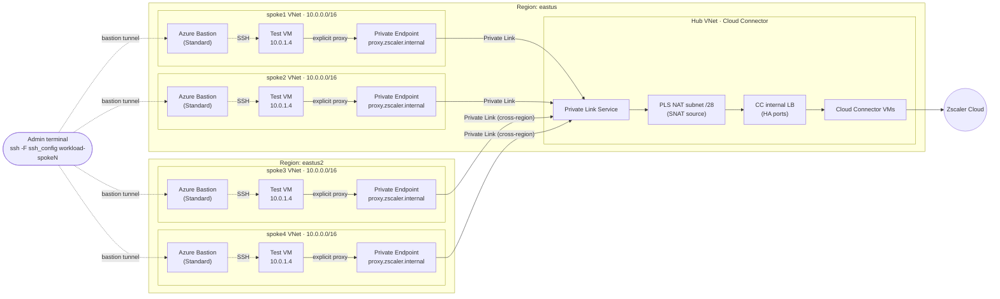

# Zscaler Cloud Connector — Azure Private Link Service Modules

Extends an existing Zscaler Cloud Connector (CC) deployment, built with
[terraform-azurerm-cloud-connector-modules](../terraform-azurerm-cloud-connector-modules), to other VNets
through **Azure Private Link**. This works even when those VNets overlap with the hub or with each other.



All spokes use the same address space (`10.0.0.0/16`) on purpose. They aren't peered with each other or the hub, so the
only path out of a spoke is its Private Endpoint. Admin SSH goes through each spoke's own Bastion
(`examples/ssh_config`), because a single hub Bastion would need peering.

## Modules

| Module | Side | Creates |
| --- | --- | --- |
| [`terraform-zscc-pls-azure`](modules/terraform-zscc-pls-azure) | Hub (provider) | Looks up the existing CC LB by name and finds its VNet from the frontend subnet. Creates a /28 NAT subnet in that VNet (by default the last /28 of its address space) and the Private Link Service on the LB frontend |
| [`terraform-zscc-spoke-network-azure`](modules/terraform-zscc-spoke-network-azure) | Spoke (consumer) | Resource group and VNet (overlapping CIDRs allowed), with a PE subnet, a private workload subnet (default outbound access disabled) and an optional Azure Bastion (Standard) |
| [`terraform-zscc-spoke-vm-azure`](modules/terraform-zscc-spoke-vm-azure) | Spoke (test) | Private Ubuntu test VM: no public IP, NSG blocks Internet, access via run-command. Includes a `proxy-test` script |
| [`terraform-zscc-pe-azure`](modules/terraform-zscc-pe-azure) | Spoke (consumer) | Private Endpoint in the spoke subnet, plus a private DNS zone, VNet link and `proxy` A record |

[`examples/cc_pls`](examples/cc_pls) deploys one PLS and, for each entry in `var.spokes`, either a new spoke network
(`address_space`) or an existing subnet (`subnet_id` + `resource_group`), plus a PE and DNS.

## Usage

```bash
cd examples/cc_pls
# create private.auto.tfvars (git-ignored) with env_subscription_id, name_prefix, cc_lb_name,
# cc_lb_resource_group; edit spokes in terraform.tfvars (NAT /28 and LB VNet are derived automatically)
terraform init
terraform plan    # should only ADD resources; nothing in the CC deployment changes
terraform apply
```

Then configure spoke workloads (OS proxy setting, PAC file or app config) to use
`proxy.zscaler.internal:<port>`, the explicit proxy port enabled on Cloud Connector.

## Multi-region spokes

A Private Link Service accepts Private Endpoints from **any** Azure region, so one PLS on the eastus Cloud Connector
can serve spokes anywhere. Set `location` per spoke:

```hcl
spoke3 = { location = "eastus2", address_space = "10.0.0.0/16", bastion_sku = "Developer" }
```

- The PE, VNet, VM and Bastion are created in the spoke's region. The PLS and Cloud Connector stay in eastus.
- Inter-region data transfer is billed, and each request adds one cross-region hop of latency.
- Zscaler egress and geolocation follow the eastus Cloud Connector (e.g. Washington DC), not the spoke's region.
- Remote spokes depend on eastus being available. For regional independence, deploy Cloud Connector + PLS in each region
  and point that region's spokes at their local PLS.

## Important limitations

- **Explicit proxy only through Private Link.** A Private Endpoint only accepts traffic sent to its own IP, so it
  can't be a UDR next hop. Transparent forwarding (`0.0.0.0/0 → LB IP`), which the hub uses today, **does not work
  from spokes through a PE**. For spokes that need transparent forwarding, a possible follow-up is a small forwarder
  (VMSS behind a spoke-local ILB used as the UDR next hop) that sends traffic to the PE explicitly.
- **Source NAT.** Cloud Connector and Zscaler see every spoke connection as coming from the PLS NAT IPs
  (`pls_nat_ips` output), not the workload IPs. Policy that keys on source IP must use those ranges. TCP Proxy
  Protocol v2 (`proxy_protocol_enabled`) can carry the original IP and the PE LinkID, but **only enable it if Cloud
  Connector supports PROXY v2**. Otherwise all traffic **and health probes** fail.
- **Idle timeout ~300s.** Long-lived connections need TCP keepalives under 5 minutes.
- **TCP/UDP, IPv4 only.** ICMP to the PE IP doesn't work.
- **Backend pool must be NIC-based**, which is what the CC modules use (`azurerm_network_interface_backend_address_pool_association`).
- **NAT subnet range.** By default the NAT subnet takes the last /28 of the LB VNet's first address space (e.g.
  `10.1.255.240/28` for `10.1.0.0/16`), which the CC network module never allocates. If that range is already in
  use in a BYO VNet, set `nat_subnet_cidr`.
- **NSG.** The NAT subnet lives in the hub VNet, so the CC service NSG's existing `ALL_VNET` inbound rule already
  allows PLS traffic. This repo doesn't add NSG rules, because CC NSGs define their rules inline and a standalone rule
  would be removed on the next apply of the CC repo. With BYO NSGs, allow inbound from the NAT subnet CIDR.
- **SNAT capacity.** Each NAT IP provides a fixed number of ports per backend. Raise `nat_ip_count` (max 8) for
  high-connection-count spokes.

## Verification

Test VMs (`test_vm_enabled = true`) run the full check, including that direct internet is blocked:

```bash
terraform output test_vms        # run_test and bastion_ssh commands per spoke

# SSH: all test VMs share one key (examples/<prefix>-key-<suffix>.pem) and Terraform writes
# examples/ssh_config. Each host hops through its spoke's Standard Bastion via bastion-proxy.sh
cd examples
ssh -F ssh_config workload-spoke1
# Requires: az login, nc, and current CLI extensions:
#   az extension add -n ssh && az extension update -n bastion   # bastion >= 1.4.3 on Python 3.12+
```

Manual checks:

```bash
# PE connection approved
az network private-link-service show -g <cc-rg> -n <pls-name> \
  --query "privateEndpointConnections[].{pe:privateEndpoint.id,status:privateLinkServiceConnectionState.status}" -o table

# From a spoke VM
nslookup proxy.zscaler.internal                      # -> PE IP
curl -s "http://proxy.zscaler.internal:<probe_port>/?cchealth"
curl -x http://proxy.zscaler.internal:<proxy_port> https://ip.zscaler.com
```
